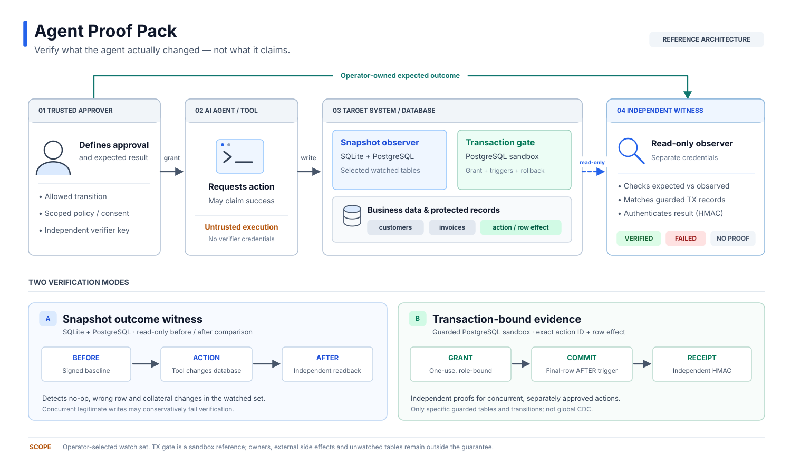

# Agent Proof Pack

**Verify database changes made by AI agents—against the database, not the agent's reply.**

An API can return 200 while an agent updates the wrong record, does nothing, or changes unrelated data. Agent Proof Pack compares the *observed before and after state* with a narrow, operator-owned outcome contract. SQLite and PostgreSQL are supported. It does not send data to an LLM.

[](https://github.com/mhatipog/agent-proof-pack/actions/workflows/ci.yml)
[](https://github.com/mhatipog/agent-proof-pack/actions/workflows/postgres-effect.yml)
[](https://github.com/mhatipog/agent-proof-pack/actions/workflows/terraform-integration.yml)

## Entra-authenticated guarded execution

The optional [Entra action executor](docs/ENTRA_ACTION_EXECUTOR.md) binds a preapproved PostgreSQL change to a signed Microsoft Entra app-only API access token. The executor checks the exact tenant, application and service principal, token audience, and dedicated `AgentProof.Apply` role before invoking the one-use transaction gate. An independent database reader must still verify the outcome. Tokens issued for Fabric, Microsoft Graph or another API cannot authorize this guard.

Run the [signed-token authorization test suite](.github/workflows/entra-authorization.yml) to exercise forged signatures, wrong identities, missing roles and expiry. Cloud access requires a separately configured, dedicated guard API registration and protected execution service; the command wrapper alone is not a security boundary against an agent with arbitrary shell access.

## Architecture



The two verification paths are deliberately distinct: read-only **before/after snapshots** support SQLite and PostgreSQL; **transaction-bound receipts** are currently demonstrated only by the protected PostgreSQL sandbox. The observer uses separate credentials, and neither mode is a general-purpose production firewall.
## Incident-class test on an established commerce database

In July 2025, a Replit agent deleted live application data. Replit later explained that development and production had shared a database, and introduced separation. **The original commands and private data are unavailable.** This repository does not claim to replay them.

Instead, [the reproducible Chinook incident lab](docs/CHINOOK_INCIDENT_LAB.md) imports a commit-pinned upstream PostgreSQL commerce database (59 customers, 2,240 invoice lines) into an ephemeral database. It tests three separately credentialed roles: a staging agent unable to access production, a production writer with narrow privileges, and an independent reader. Destructive operations and frozen writes are refused; an unauthorized invoice-line change in the same transaction aborts an otherwise permitted customer update.

The [configurable single-row transaction gate](docs/GENERIC_TRANSACTION_GATE.md) also runs on Chinook's actual `customer.email` and `invoice_line` tables, not just the earlier hard-coded fixture. It uses one-use, role-bound grants with revocation and rollback, then checks the committed result separately.

**Agent integration:** `agent-guarded apply --action-id <approved-uuid>` accepts only an operator-issued ID—not SQL or a policy change. A separate process runs `agent-guarded observe` using SELECT-only credentials and an HMAC key; `agent-guarded check` requires the exact operator contract and a recent, verified receipt. The gate compares the entire final row after immediate triggers, refusing unexpected changes made by later BEFORE triggers. See the [bounded setup](docs/GENERIC_TRANSACTION_GATE.md). [Inspect the PostgreSQL tests](.github/workflows/chinook-incident.yml).

**Scope:** verified incident *class* on an independent sample database, not a customer deployment or a reconstruction of Replit's exact failure. Enforcement relies fundamentally on PostgreSQL permissions and transactions. A database owner can bypass the guard.

## One-command live transaction proof (disposable PostgreSQL)

For a real, completely isolated demonstration with **two concurrent approved customer updates**, independently authenticated outcomes, and a forbidden invoice write, run from the repository root:

```sh
python -m pip install -e '.[postgresql]'
python -m scripts.tx_quickstart
```

This starts a randomly named, disposable `postgres:16` Docker container on a randomly assigned **localhost-only** port, creates separate approver/actor/witness identities, verifies two committed actions and rejects a direct unauthorized invoice modification. The container is deleted on completion, and **no existing database or customer credentials are used**. Requires a working local Docker daemon. `--show-receipt` prints a value-redacted, demonstration-only signed outcome bundle; its ephemeral signing key is intentionally discarded.

Use [`agent-tx-effect`](docs/TRANSACTION_EVIDENCE.md) with protected reader credentials to verify an actual existing sandbox action, and `agent-tx-verify` to authenticate a saved receipt later using the separately held verifier key.
## Transaction effect gate (experimental PostgreSQL sandbox)

The existing witness detects unintended changes **after** a database operation. The new [transaction effect gate](docs/TRANSACTION_GATE.md) demonstrates preventing an unintended change **before commit**.

A separate approver records a one-use authorization for an exact database role, customer row and status transition. The agent role can invoke one protected PostgreSQL function, not modify the tables directly. A trusted transaction-local context plus row triggers refuse every other customer change and any invoice change in this sandbox. If a second trigger tries to zero an invoice, PostgreSQL rolls back **the customer update, the invoice change and the approval consumption together**. A trusted record is visible only after successful commit. The [transaction-bound effect witness](docs/TRANSACTION_EVIDENCE.md) now checks an **AFTER-trigger observation of the final row** against that committed action and a protected grant, using three keyed database lookups rather than full-table scans. Two concurrent, independently approved customer changes can each receive an authenticated outcome without falsely rejecting the other. An aborted transaction or late BEFORE-trigger rewrite cannot produce a valid proof. This does **not** expand the sandbox's two-table security boundary.

[Real PostgreSQL 16 integration tests](tests/integration_tx_gate.py) exercise malicious nested triggers, replay, expiry, wrong role, forged session variables, concurrent attempts and independent readback. This is deliberately specific to two demo tables, **not a general production database firewall**. Database owners can bypass the protection; external side effects and unwatched tables remain out of scope.

## See the problem in 30 seconds

Clone the repo; no external database, cloud credentials or agent framework are needed.

```sh
python -m agentproof.effect_cli demo --mode correct     # exits 0
python -m agentproof.effect_cli demo --mode no-op       # exits 4
python -m agentproof.effect_cli demo --mode collateral  # exits 4
```

All three operate on a **real, disposable SQLite database**:

| Operation | What the agent/tool reports | What the independent witness finds |
| --- | --- | --- |
| Update customer C-42 | Success | Correct status; no other watched changes → verified |
| Return success without changing anything | Success | Required mutation did not occur → rejected |
| Update C-42 **and zero an invoice** | Success | Unauthorized change in `invoices` → rejected |

This is read-after-write **outcome verification**, not an agent-success classifier. The verifier reads only from a separately controlled source of truth and never executes SQL supplied by the agent.

## PostgreSQL: real DB, separate read-only account

```sh
python -m pip install -e '.[postgresql]'
```

`agent-effect` can capture and reconcile observations using a PostgreSQL account granted **SELECT only** on explicitly watched tables, inside consistent read-only snapshots. The live CI test boots PostgreSQL 16 and verifies correct updates, silent no-ops, wrong rows, collateral invoice changes, unexpected inserts, RLS masking, and schema/index changes. **Typed PostgreSQL columns** now include UUID keys, exact NUMERIC decimals, booleans, and timezone-aware timestamps; unsupported column types still fail closed.

See [the PostgreSQL setup and CLI](docs/POSTGRESQL.md) and [its actual integration tests](tests/integration_postgres.py).

## Effect contract

The operator writes a small JSON contract; the agent does **not** get to change it. [Example](examples/proof_of_effect/contract.json):

```json
{
  "schema": "agent-proof-pack/effect-contract/v2",
  "id": "crm_status",
  "watch_tables": ["customers", "invoices"],
  "target": {
    "table": "customers",
    "key_column": "id",
    "key": "C-42",
    "expected": {"status": "won"},
    "allowed_columns": ["status"],
    "require_change": true
  }
}
```

The witness signs a value-redacted before-snapshot, reads the database independently after the operation, checks the target and **all other rows/columns within watched tables**, then issues a signed outcome bundle. A changed index or trigger is a schema change. Missing/stale evidence fails closed.

The result uses the [in-toto Statement v1](https://github.com/in-toto/attestation) shape, with a custom predicate and verifier-held HMAC. [GitHub's existing `actions/attest`](https://github.com/actions/attest) signs provenance of the **synthetic CI artifact**, not customer outcome truth. No custom PKI or model-specific SDK.

[Read the evidence format, threat boundaries and limitations](docs/PROOF_OF_EFFECT.md).

## Terraform: checked saved plans, scoped approvals and observed results

The earlier [Terraform gate](docs/TERRAFORM_GATE.md) is still included: read-only reviews of saved binary plans, explicit policy for resource types/actions, rejection of unapproved deletes and state changes, short-lived signed approvals for an optional protected executor, and independent filesystem readback for the local sandbox.

```sh
python -m agentproof terraform --plan-json examples/terraform/safe-plan.json \
  --policy examples/terraform/policy.json
```

The public GitHub [composite Action](action.yml) checks saved Terraform plans **without applying them**.

## Install / test

```sh
python -m pip install -e .
python -m unittest discover -s tests -v
python -m agentproof suite
python -m agentproof suite --cases examples/incident_cases.json
```

Python 3.10+, MIT license; no runtime dependencies for SQLite. PostgreSQL support uses the optional established `psycopg` library.

## Boundaries

The witness is useful precisely because it says what it **doesn't** prove:

- `verified` means **the expected mutation occurred and no unauthorized changes were observed in the configured watch set** during two observations. It does not establish causal attribution or the absence of changes to unwatched systems.
- A read-only observer cannot prevent an unsafe write; enforce least privilege and authorization *at the actual write boundary*. Protect signing keys, before-snapshots, contracts and the verifier from the agent.
- Whole-table comparison has intentionally strict limits (8 tables; 10,000 rows/table; 200,000 cells). High-churn or large production datasets need CDC and transaction-linked evidence, not this reference scanner.
- The PostgreSQL adapter deliberately rejects row-level security filtering and unsupported database types rather than silently dropping evidence. This is a research/pilot implementation, **not a production-certified audit platform**.

[Threat model](docs/SECURITY.md) · [Incident-grounded regression scenarios](docs/INCIDENT_EVIDENCE.md) · [Contributing](CONTRIBUTING.md)

### Pilot

Have a database-changing agent running in a sandbox with a separately readable source of truth? A useful pilot is one operation, one narrow contract, and ten failing/passing examples—not a broad promise to "trust AI." [See the field-pilot scope](docs/FIELD_PILOT.md) or [open a privacy-safe request](.github/ISSUE_TEMPLATE/pilot.yml). **Never post production data or secrets in public GitHub issues.**
